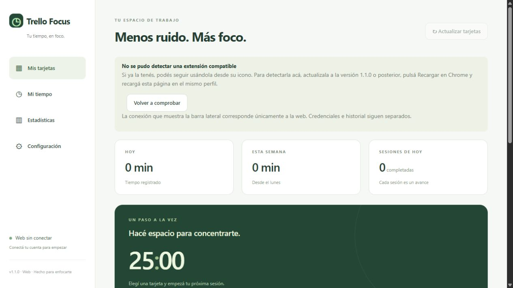

# Trello Focus

**Registrá tiempo y sesiones de concentración en tus tarjetas, con una web y una extensión independientes.**

[](https://github.com/GermanBartoli/trello-focus)
[](https://github.com/GermanBartoli/trello-focus/actions/workflows/verificar.yml)

[Abrir en Cloudflare](https://trello-focus.pages.dev/) · [Descargas](https://github.com/GermanBartoli/trello-focus/releases) · [Empezar](#primeros-pasos) · [Mapa del repositorio](#mapa-del-repositorio) · [Autoría](#autoría-de-esta-documentación)



*Captura de la página publicada, tomada el 9 de noviembre de 2026. Conservada sin redimensionar ni recomprimir.*

## Recuperar datos locales dañados

Si el historial local no se puede leer, aparece **Recuperar datos locales**. Podés descargar el contenido original o pulsar **Guardar respaldo y restablecer**: primero conserva una copia en el mismo navegador y luego inicia un historial local vacío. No modifica tarjetas, comentarios ni credenciales de Trello. Si no hay espacio para el respaldo, no restablece los datos. El respaldo permanece disponible para descargar y revisar después.

## Primeros pasos

1. Elegí web o extensión. La extensión agrega el panel dentro de Trello; la web también funciona por separado.
2. Conectá tu cuenta en Configuración siguiendo la guía de instalación.
3. Elegí una tarjeta, iniciá una sesión o sumá tiempo manual, y revisá Mi tiempo y Estadísticas. Exportá el historial para conservar un respaldo.

## Referencia y detalles

Aplicación web y extensión de Chrome independientes para registrar tiempo en Trello, creada con TypeScript, React, CSS, Vite y Manifest V3. Proyecto independiente, sin afiliación con Trello, Atlassian ni Pomello.

## Web y extensión

La [web pública](https://trello-focus.pages.dev/) funciona sin instalar nada. En Configuración, cada persona conecta su cuenta con una API key de su aplicación de Trello y un token autorizado. No se comparte la cuenta del creador. La extensión sigue funcionando por sí sola; es necesaria para el panel flotante dentro de trello.com.

Ambas versiones usan el mismo motor de sesiones y sincronización de comentarios. La extensión conserva `chrome.storage.local`; la web guarda credenciales e historial en el almacenamiento local de su propio origen HTTPS. No se transfieren automáticamente los registros entre web, extensión o equipos. Evitar registrar simultáneamente la misma tarjeta desde ambas versiones. Exportar el historial antes de borrar datos del navegador. Cloudflare sirve archivos estáticos: las llamadas autorizadas salen del navegador directamente a Trello.

En la web, mantener la pestaña abierta para finalizar sesiones y recibir notificaciones. Al volver después de un cierre o suspensión, se recupera el estado y se solicita revisar sesiones vencidas tardíamente. Las operaciones entre pestañas se coordinan mediante Web Locks; no se usa una cuenta ni base de datos compartida.

[Descargar la última versión de la extensión](https://github.com/GermanBartoli/trello-focus/releases/latest).

Desde la versión 1.1.0, la web oficial detecta la extensión instalada en el mismo perfil y permite abrir su panel sin conectar la web. El canal solo comunica la versión y el resultado de apertura; no comparte credenciales, cuenta ni historial. La apertura requiere pulsar el botón. La ausencia de respuesta también puede significar una versión antigua o permisos del sitio restringidos. Tras actualizar, pulsar Recargar en Chrome y recargar la web. No desinstalar la extensión.

## Instalación

1. Descargar el ZIP de la última versión desde Releases y descomprimirlo en una carpeta permanente.
2. Abrir `chrome://extensions`, activar **Modo desarrollador** y elegir **Cargar descomprimida**. Seleccionar la carpeta que contiene `manifest.json`.
3. Abrir el icono de Trello Focus y pulsar **Abrir mi panel** → **Configuración**.
4. Crear una aplicación propia en <https://trello.com/apps/admin>, obtener su API key, ingresarla y pulsar **Abrir autorización de Trello**. Autorizar lectura y escritura durante 30 días, copiar el token mostrado por Trello e ingresarlo en la extensión. El token de Pomello no funciona en esta integración.
5. Pulsar **Conectar cuenta** y abrir una tarjeta en Trello. Si ya estaba abierta al instalar, recargarla.

El usuario final no necesita Node.js ni `node_modules`. Para actualizar una instalación manual, reemplazar los archivos en la misma carpeta y pulsar **Recargar** en Chrome. No desinstalar: Chrome elimina el historial local al hacerlo.

## Funciones

- Panel flotante en las tarjetas de Trello: sumar horas/minutos e iniciar una sesión.
- El panel flotante muestra la cuenta regresiva, pausa, continuación, finalización y errores exclusivos de la tarjeta abierta. Iniciar una sesión publica su estado en el comentario; solo se suma el tiempo al terminar.
- Permite descartar sincronizaciones fallidas conservando el historial local. No vuelve a enviarlas automáticamente; una nueva carga manual o sesión en esa tarjeta inicia una nueva búsqueda de comentario.
- Configuración con estado de conexión visible y marcadores ocultos de credenciales guardadas; sus valores no se devuelven a la interfaz.
- Popup con temporizador y acceso al panel completo.
- Panel con tarjetas asignadas, tableros, listas, búsqueda y favoritas. Seleccionar un tablero permite cargar sus tarjetas no asignadas.
- Filtro **Activas / Archivadas / Todas**, con **Activas** como valor inicial. Se recuerda la última opción elegida en este perfil de Chrome. Incluye tarjetas dentro de listas o tableros archivados. El filtro se combina con búsqueda, tablero, lista, asignación y favoritas; no desarchiva tarjetas ni importa tiempo previo.
- Orden por tiempo acumulado (mayor/menor) o fecha del último trabajo registrado (reciente/antiguo), con elección persistente. Los órdenes de fecha dejan al final las tarjetas sin registros. Se utiliza el historial local de Trello Focus, no la actividad general de Trello ni el tiempo pendiente de una sesión activa.
- Una sola sesión activa, pausa, continuación, finalización anticipada y descarte.
- Duración configurable entre 1 y 180 minutos y notificación de finalización.
- Un comentario propio por tarjeta y cuenta. Las cargas siguientes editan ese comentario; Pomello permanece independiente.
- Historial local y resumen diario/semanal, exportable a JSON sin credenciales.

## Persistencia y límites de la primera versión

El perfil de Chrome es la fuente del historial. Usar una sola computadora/perfil para registrar tiempo. No hay sincronización entre equipos ni importación de respaldos en esta versión. Se conserva el usuario asociado para evitar mezclar registros al conectar otra cuenta.

Las cargas sobre tarjetas ya conocidas se guardan localmente antes de sincronizar. Sin conexión, se muestran pendientes y se reintentan desde el panel. Resolver una tarjeta nueva requiere conexión. Una creación de comentario con resultado incierto se busca antes de reintentar; si no puede confirmarse, queda bloqueada para evitar duplicados. No se sobrescriben comentarios editados manualmente ni se reemplazan silenciosamente comentarios eliminados. La recuperación de esos conflictos es manual; conservar el perfil y exportar los datos.

El comentario muestra el total completo y los últimos 60 registros. El historial completo permanece local. La búsqueda de un comentario incierto inspecciona hasta 1000 comentarios recientes: ante dudas se detiene. Al reinstalar o usar otro perfil, detectar un registro existente bloquea su sobrescritura si no coincide con el historial local.

Si el navegador se cierra o una alarma llega más de 90 segundos tarde, una sesión vencida requiere confirmación. Una suspensión corta puede contabilizarse como tiempo de sesión. La sesión nunca suma más que su duración prevista. Las notificaciones dependen de Chrome y de los permisos del sistema operativo.

## Privacidad

La extensión se comunica únicamente con la API de Trello para sus funciones. No tiene servidor propio ni telemetría. Credenciales e historial se almacenan en `chrome.storage.local`, con acceso restringido a contextos confiables de la extensión. No se usa sincronización de Chrome para credenciales. Este almacenamiento no es una bóveda cifrada independiente: proteger el perfil de Windows/Chrome.

El script de la tarjeta recibe solamente la configuración mínima y envía acciones al proceso de fondo. No recibe el token. Los permisos son `storage`, `alarms`, `notifications`, acceso a la API y al dominio `trello.com` para comprobar la URL actual de la pestaña, un script en `trello.com` y un script de detección exclusivamente en `https://trello-focus.pages.dev/*`. **Desconectar autorización** elimina la credencial local; para revocar el acceso en Trello usar la administración de aplicaciones de la cuenta.

## Desarrollo

Requiere Node.js 24 o superior.

```powershell
pnpm install --frozen-lockfile
pnpm run build
pnpm test
pnpm run dev
```

`pnpm run dev` ejecuta la aplicación web real. Para probar la extensión cargar `dist` en Chrome. La compilación produce el panel React, un service worker y un script de contenido independientes. Todas las dependencias de ejecución quedan empaquetadas; no se carga código remoto.

## Verificaciones

Las pruebas automatizadas cubren duración, pausa, validación, deduplicación, actualización del mismo comentario, reintentos de red, creación incierta, conflictos de edición, sesión única y control de mensajes desde Trello. Usan la lógica real y el worker compilado con API/Chrome simulados; no sustituyen una prueba con cuenta real autorizada.

El flujo de GitHub Actions compila, ejecuta pruebas y adjunta la carpeta instalable en cada push. La web se compila con `pnpm run build:web` en `dist-web`; GitHub Actions publica esta carpeta en Cloudflare Pages al recibir cambios en `main`, después del build y las pruebas. `scripts/deploy-web.mjs` utiliza la API oficial con secretos de Actions; no requiere credenciales en el código.

## Historial y navegación

Cada registro permite editar horas, minutos, segundos y nota, o eliminarlo con confirmación. Se conservan fecha y tipo al editar; los totales y el comentario propio se actualizan al sincronizar. Si la sincronización fue descartada, los cambios permanecen locales.

El título de una tarjeta abre su detalle dentro del panel, con historial y enlace a Trello. Cada sección tiene su URL (`?view=cards`, `?view=history`, `?view=settings` y `?view=card&card=ID`), compatible con recarga y Atrás/Adelante.

En el panel flotante de Trello, **Ver historial de esta tarjeta** abre directamente su detalle en Trello Focus. El botón general del panel sigue disponible.

El formulario flotante usa un documento aislado para evitar activar atajos de Trello al escribir. Los filtros de búsqueda, tablero, lista, asignación y favoritas se recuerdan en el mismo perfil, además del estado y orden existentes.

## Comentarios, notas y edición de tarjetas

- **Comentario en Trello:** publicación normal e independiente del contador de horas. Permite editar comentarios propios desde un modal.
- **Nota de Trello Focus:** texto independiente, sin duración, dentro del mismo comentario que registra el total. Se puede editar sin sumar minutos.
- **Mensaje de sesión o carga manual:** nota opcional junto al registro de tiempo. La nota de sesión se conserva al terminar y puede cambiarse desde el temporizador.

El editor permite escribir texto normal, enlaces, negritas y bloques de código opcionales con selector de lenguaje. Envía Markdown a Trello; su representación exacta depende del editor de Trello. La vista previa local muestra enlaces, imágenes y código sin interpretar HTML.

Las fotos y documentos se adjuntan inmediatamente a la tarjeta y se insertan en el borrador del comentario. Cancelar el borrador no elimina un archivo ya adjuntado. Límite de esta versión: 10 MB por archivo, sujeto a permisos y límites de Trello. Las imágenes privadas pueden requerir iniciar sesión en Trello para visualizarse.

Desde el detalle se pueden editar título, descripción, lista y miembros existentes del tablero; ver y subir adjuntos; usar una imagen como portada o elegir color; agregar Taco cool o stickers personales ya disponibles en la cuenta, y quitar stickers. Trello ofrece rosa y violeta, pero no un valor de portada llamado magenta. Color e imagen son alternativas de portada. No se crean miembros ni se invita a personas al tablero.

Los envíos de comentarios, adjuntos y stickers no se reintentan automáticamente. Si una respuesta se pierde, se conserva un comprobante local para impedir repetir esa misma operación; revisar la tarjeta antes de iniciar otra publicación. El historial de tiempo conserva su sincronización independiente.

Referencia: [API oficial de tarjetas](https://developer.atlassian.com/cloud/trello/rest/api-group-cards/) y [formato de texto de Trello](https://support.atlassian.com/trello/docs/how-to-format-your-text-in-trello/).

## Filtros y creación de tarjetas

Los filtros de persona, etiqueta, vencimiento y finalización se combinan con tablero, lista, búsqueda, estado y orden. Se recuerdan al recargar en el mismo perfil. Elegir una persona desactiva «Asignadas a mí». Actualizar todos los tableros carga también tarjetas de otros miembros; puede tardar más en cuentas con muchos tableros.

«Crear tarjeta» permite elegir tablero y lista activa, título, descripción Markdown, miembros, etiquetas y vencimiento opcional. Al crearla abre su detalle. Valida que la lista y las selecciones pertenezcan al tablero y protege el mismo envío contra duplicados.

## Estadísticas

La sección Estadísticas muestra cuatro gráficos: tiempo diario de la semana, cinco tarjetas con más dedicación, distribución por tablero y sesiones frente a cargas manuales. Incluye tiempo total, promedio diario, días activos, sesiones guardadas y comparación con la semana anterior completa. Permite recorrer semanas y abrir el historial desde el ranking.

Se calcula a partir del historial local, sin servicios externos ni dependencias nuevas. Incluye tarjetas archivadas y registros de tarjetas que ya no están cargadas. Usa la fecha local de cada registro; las sesiones en curso y las fechas futuras no se contabilizan. El promedio actual incluye los días transcurridos, incluido hoy; en semanas anteriores divide por siete. Editar o eliminar registros actualiza las cifras.

## Portadas y prioridad visual

En Mis tarjetas, «Mostrar portada» permite ver una mini portada de color o imagen arriba, a todo el ancho. Está desactivado inicialmente y recuerda la preferencia. «Prioridad: rojo → rosa → verde» ordena primero esos colores; los demás colores, imágenes y tarjetas sin portada quedan después, conservando su orden relativo. El orden se guarda y funciona aunque las portadas estén ocultas. Usá Actualizar tarjetas para cargar los cambios de portada realizados en Trello.

Si hay tarjetas guardadas por una versión anterior sin datos de portada, al mostrarlas o elegir el orden por color el panel las actualiza automáticamente una vez por apertura. La carga conserva el historial y las preferencias. Si falla la conexión, se puede reintentar con Actualizar tarjetas.

## Recuperación al reintentar

Reintentar sincronización puede recuperar un comentario previo de Trello Focus cuando el perfil perdió su asociación con él. Verifica autor, tarjeta, formato y total; incorpora registros faltantes, conserva los locales y actualiza el mismo comentario. Antes de unir guarda una copia local de recuperación. Los reintentos no vuelven a sumar registros.

Los comentarios antiguos con historial truncado, notas generales, sesiones abiertas, cambios externos o fechas ambiguas no se sobrescriben automáticamente. En esos casos se informa el bloqueo para revisarlos sin perder datos. La recuperación no sustituye una copia de seguridad ni sincroniza todos los perfiles.

## Tiempo manual predeterminado

Configuración → Tu ritmo de trabajo permite guardar horas y minutos para nuevas cargas manuales (entre 1 minuto y 24 horas). Se conserva en el perfil y se aplica al modal del panel y al formulario flotante de Trello. Los perfiles anteriores comienzan en 15 minutos. Cambiar una carga individual no modifica esta preferencia; el panel flotante no pisa valores que ya estés escribiendo.

## Últimas correcciones de uso

La versión 1.1.2 distribuye el menú móvil en dos columnas para que Configuración permanezca visible. Desde 1.1.1, repetir la orden de reanudar no reinicia el vencimiento de una sesión ya activa. Para actualizar la extensión, reemplazá sus archivos en la misma carpeta y pulsá Recargar en Chrome; no la desinstales.


## Mapa del repositorio

- [package.json](<package.json>)
- [index.html](<index.html>)

## Autoría de esta documentación

Repositorio mantenido por [Germán Bartoli](https://github.com/GermanBartoli). Guía revisada y actualizada con **Codex**, coautor de esta actualización documental. Los autores, colaboradores, licencias y recursos de terceros conservan sus créditos originales.

Los commits de esta revisión incluyen `Co-authored-by: Codex <noreply@openai.com>`; esta atribución no modifica la autoría del historial anterior.

<!-- firma-german-bartoli -->
<p align="center">
  <a href="https://germanbartoli.pages.dev/">
    <br />
    Hecho por Germán Bartoli · Ver portfolio
  </a>
</p>
